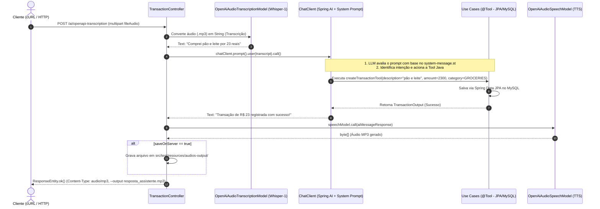

# 💰 Budgeting AI Assistant & Transaction API

Documentação técnica completa da aplicação **Spring Boot** para gestão financeira, cobrindo a arquitetura de infraestrutura, configuração de Inteligência Artificial com **Spring AI**, serviços conteinerizados via **Docker**, e um guia aprofundado do pipeline multimodal de áudio.

---

## 🏗️ 1. Infraestrutura & Persistência de Dados

A camada de persistência utiliza **Spring Data JPA** acoplada ao **MySQL**, seguindo princípios de Domain-Driven Design (DDD) e arquitetura limpa.

### Configuração JPA (`application.yml`)
```yaml
spring:
  datasource:
    url: jdbc:mysql://localhost:3307/transaction
    username: app
    password: 4563!app
  jpa:
    hibernate:
      ddl-auto: update
    show-sql: true
```

---

## 🐳 2. Configuração de Docker Compose

O projeto possui integração nativa com o **Spring Boot Docker Compose**, inicializando o banco de dados MySQL automaticamente ao iniciar a aplicação (`bootRun`).

### Arquivo `compose.yml` (Raiz do Projeto)
```yaml
services:
  database:
    image: mysql:9.6
    environment:
      MYSQL_DATABASE: transaction
      MYSQL_ROOT_PASSWORD: root
      MYSQL_USER: app
      MYSQL_PASSWORD: 4563!app
    ports:
      - "3307:3306"
    volumes:
      - transaction_data:/var/lib/mysql
    healthcheck:
      test: ["CMD", "mysqladmin", "ping", "-h", "localhost", "-uapp", "-p4563!app" ]
      interval: 5s
      timeout: 5s
      retries: 5

volumes:
  transaction_data:
```

---

## 🤖 3. A Cereja do Bolo: O Pipeline Multimodal de IA (`/ai/openapi-transcription`)

Este endpoint é o expoente máximo da integração com **Spring AI**, combinando três grandes capacidades da OpenAI em uma única requisição HTTP: **Audio Transcription (Whisper)**, **Tool Calling (Function Calling)** e **Text-to-Speech (TTS)**.

### O Comando cURL de Exemplo
```bash
curl -X POST --location "http://localhost:8080/api/transaction/ai/openapi-transcription?saveOnServer=true" \
-H "Content-Type: multipart/form-data" \
-F "fileAudio=@src/test/resources/audios/audio_padaria_paoleite.mp3" \
--output resposta_assistente.mp3
```

---

## 🔄 4. Passo a Passo do Pipeline (Step by Step)

Abaixo está o detalhamento técnico de cada etapa executada pelo endpoint:

### Passo 1: Entrada (Multipart Request)
- O cliente envia um arquivo de áudio (`.mp3`) via `multipart/form-data` no parâmetro `fileAudio`.
- O parâmetro opcional `?saveOnServer=true` indica se o áudio de resposta gerado deve ser salvo no disco do servidor.

### Passo 2: Transcrição de Áudio (Speech-to-Text com Whisper)
- O arquivo é encapsulado em um `Resource` e enviado ao `OpenAiAudioTranscriptionModel` utilizando o modelo `whisper-1`.
- Configurações aplicadas:
  - Idioma: Português (`pt`).
  - Temperatura: `0f` (maior determinismo).
  - Prompt direcionado: Orienta o Whisper a reconhecer termos financeiros em reais (`R$`), estabelecimentos (padaria, farmácia, mercado) e ações de compra.
- **Resultado:** O áudio falado é convertido em uma **String de texto** pura (ex: *"Pasei na padaria e comprei pão e leite, tudo ficou R$ 23"*).

### Passo 3: Processamento com IA e Tool Calling (Function Calling)
- A string transcrita é enviada ao `ChatClient` (configurado localmente no `TransactionController`).
- **System Prompt:** Carregado externamente via arquivo de template (`src/main/resources/prompts/system-message.st`), que define o papel do assistente:
  > *"Você é um assistente financeiro inteligente. Sua tarefa é extrair dados de transações e usar as ferramentas disponíveis para manipular transações..."*
- **Default Tools:** O `ChatClient` possui registradas duas ferramentas (`@Tool`) mapeadas diretamente nos Use Cases da aplicação:
  1. `createTransactionTool` (`PersistTransactionUseCase`): Persiste a transação no MySQL.
  2. `listTransactionsByCategoryTool` (`ListTransactionsByCategoryUseCase`): Consulta transações por categoria.
- **Execução Automática:** O LLM da OpenAI analisa a frase transcrita, identifica a intenção (criar uma transação do tipo `GROCERIES`), preenche os parâmetros e **chama automaticamente o método Java**. Após a execução no banco de dados, a IA recebe o resultado e redige uma resposta textual amigável (ex: *"Transação de R$ 23 registrada com sucesso na categoria GROCERIES!"*).

### Passo 4: Geração de Resposta em Voz (Text-to-Speech - TTS)
- A resposta textual gerada pela IA é enviada ao `OpenAiAudioSpeechModel`.
- Configurações do TTS:
  - Modelo: `gpt-4o-mini-tts`
  - Voz: `NOVA` (feminina, natural, descontraída)
  - Velocidade: `1.2`
  - Instruções: *"Fale em português brasileiro, utilize voz natural e descontraída."*
- **Resultado:** A string de resposta é convertida em um **array de bytes de áudio MP3**.

### Passo 5: Persistência Opcional e Resposta HTTP
- Se `saveOnServer=true`, o array de bytes é salvo no diretório `src/test/resources/audios-output/` com timestamp (`AUDIO_output_<timestamp>.mp3`).
- O endpoint retorna um `ResponseEntity<Resource>` com `Content-Type: audio/mp3`, permitindo que o cliente salve diretamente o arquivo `--output resposta_assistente.mp3`.

---

## 📊 5. Diagrama de Sequência do Endpoint (`/ai/openapi-transcription`)



---

## 🔌 6. Outros Endpoints de Suporte

### Criar Transação via REST Tradicional (JSON)
- **POST** `/api/transaction`
```bash
curl -X POST --location "http://localhost:8080/api/transaction" \
-H "Content-Type: application/json" \
-d '{
"description": "Compra no mercado",
"category": "GROCERIES",
"amount": 35067
}'
```

### Consultar Transações por Categoria
- **GET** `/api/transaction/{category}` (ex: `GROCERIES`, `PHARMA`, `AUTO`)
```bash
curl -X GET --location "http://localhost:8080/api/transaction/GROCERIES"
```
